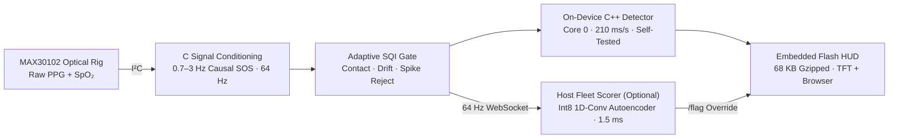

# PULSE // Bare-Metal Edge-AI Biometric Anomaly Engine


**PULSE** is a privacy-preserving, zero-cloud physiological anomaly detection engine that executes end-to-end on bare-metal microcontroller silicon (**ESP32-S3 + MAX30102 PPG**). Raw biometric waveforms never leave the device: signal conditioning, quality gating, one-class anomaly scoring, and real-time WebSocket UI serving run directly on the board.

---

## System Architecture



---

## Verified Engineering Benchmarks

| Subsystem | Metric / Verification | Implementation |
| :--- | :--- | :--- |
| **1D-Conv Autoencoder** | **0.706 PR-AUC** (WESAD Leave-One-Subject-Out) | Bottleneck-redesigned one-class neural detector (`anomaly/`) |
| **Quantized Edge Export** | **4.0 MB `int8` TFLite** · **1.5 ms / window** | Fits `ESP32-S3-N16R8` PSRAM envelope with zero host dependency |
| **On-Board C++ Kernel** | **0.635 PR-AUC** · **~210 ms/s on Core 0** | Ported Mahalanobis + movement gate (`pulse_display/board_detector.h`), boot-verified (`/health -> self=pass`) |
| **C Signal Conditioning** | **`1.7e-9` numerical parity** vs. Python `scipy` | Causal `sosfilt` bandpass + 64 Hz resampler running natively in firmware |
| **Sensor-Transfer Calibration** | **100% $\rightarrow$ 10% false-positive rate** | Live per-user calm baseline calibration (`anomaly/device_calibrate.py`) |
| **Zero-Cloud Embedded UI** | **68 KB gzipped** (232 KB raw) in SPIFFS/Flash | Served directly over ESP32 Wi-Fi + real-time 64 Hz WebSocket telemetry |

---

## Repository Layout

```text
├── anomaly/            # 1D-Conv Autoencoder, SSL encoder, calibration engine, TFLite & C++ exporters
├── pulse_display/      # ESP32-S3 + TFT firmware, C signal conditioning, C++ Core-0 detector & Flash UI
├── pulse_headless/     # Headless sensor node firmware target
├── pipeline/           # Real-time WebSocket telemetry & Pulse Watch live monitor / fleet orchestrator
├── baselines/          # Statistical & supervised benchmark baselines
├── security/           # Transport & device hardening utilities
└── tests/              # Numerical parity & pipeline verification tests
```

---

## Quick Start

Requires **Python 3.12** (`./run` on macOS/Linux or `.\run.ps1` on Windows bootstraps an isolated environment automatically):

```bash
# 1. Bootstrap Python 3.12 environment & dependencies
./run setup

# 2. Launch the interactive Pulse Watch & Developer Telemetry HUD (offline replay mode)
./run anomaly.serve      # -> http://localhost:8001

# 3. Connect to live ESP32-S3 nodes streaming 64 Hz PPG over LAN WebSockets
./run anomaly.fleet      # -> http://localhost:8002
```

For full firmware flashing (`ESP32-S3-N16R8` + `MAX30102`) and calibration commands, see:
- [`anomaly/README.md`](anomaly/README.md) — One-class detector, evaluation harness & live calibration
- [`anomaly/RESULTS.md`](anomaly/RESULTS.md) — Subject-wise LOSO benchmarks (`PR-AUC`, `Recall @ 90% Spec`)
- [`COMMANDS-windows.md`](COMMANDS-windows.md) / [`COMMANDS-macos.md`](COMMANDS-macos.md) — Hardware bring-up & serial/OTA workflows
