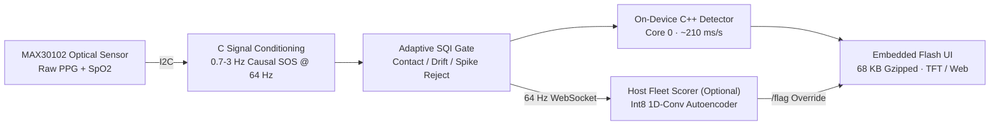
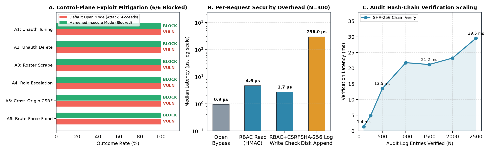

# pulse-edge-ai

[](https://github.com/al9eri/pulse-edge-ai/actions)
[](https://opensource.org/licenses/MIT)

On-device physiological anomaly detection and telemetry supervision on bare-metal microcontroller silicon (**ESP32-S3 + MAX30102 PPG**). Developed as a Senior Design Project (`COSC 498`) at Khalifa University.

Raw photoplethysmogram (PPG) waveforms are sampled over I2C, conditioned through a causal second-order section (SOS) bandpass filter, gated for contact quality, and scored for anomalies on-device (Mahalanobis distance on Core 0) with an optional quantized host autoencoder (Int8 1D-CNN) and SHA-256 tamper-evident supervision server.

---

## System Architecture



---

## Benchmarks & Implementation Details

| Subsystem | Metric / Verification | Implementation |
| :--- | :--- | :--- |
| **1D-Conv Autoencoder** | **0.706 PR-AUC** (WESAD Leave-One-Subject-Out) | Bottleneck one-class neural detector (`anomaly/`) |
| **Quantized Edge Export** | **4.0 MB `int8` TFLite** · **1.5 ms / window** | Fits `ESP32-S3-N16R8` PSRAM envelope |
| **On-Board C++ Kernel** | **0.635 PR-AUC** · **~210 ms/s on Core 0** | Ported Mahalanobis + movement gate (`pulse_display/board_detector.h`) |
| **C Signal Conditioning** | **`1.7e-9` numerical parity** vs. Python `scipy` | Causal `sosfilt` bandpass + 64 Hz resampler running natively in firmware |
| **Sensor Calibration** | Baseline adaptation | Per-user calm baseline calibration (`anomaly/device_calibrate.py`) |
| **Embedded UI** | **68 KB gzipped** (232 KB raw) in SPIFFS/Flash | Served directly over ESP32 Wi-Fi + real-time 64 Hz WebSocket telemetry |

---

## Scope & Known Limitations

- **Motion Artifacts:** Like all single-site reflective PPG sensors (MAX30102), optical readings degrade significantly during gross hand or wrist movements. An adaptive SQI gate rejects low-quality windows rather than guessing.
- **LOSO Baseline:** The 1D-CNN achieves `0.706` PR-AUC on the benchmark WESAD dataset under Leave-One-Subject-Out (LOSO) cross-validation. Real-world generalization varies by skin tone and contact pressure; an onboarding calibration script (`anomaly/device_calibrate.py`) is provided to establish per-user baselines.
- **CI Environment:** Automated CI tests (`tests/`) run numerical parity checks against recorded sensor sessions and simulated serial streams without requiring physical hardware attached to GitHub runners.

---

## Repository Layout

```text
├── anomaly/            # 1D-Conv Autoencoder, SSL encoder, calibration engine, TFLite & C++ exporters
├── pulse_display/      # ESP32-S3 + TFT firmware, C signal conditioning, C++ Core-0 detector & Flash UI
├── pulse_headless/     # Headless sensor node firmware target
├── pipeline/           # Real-time WebSocket telemetry & Pulse Watch live monitor / fleet orchestrator
├── baselines/          # Statistical & supervised benchmark baselines
├── security/           # Transport & device hardening utilities
└── tests/              # Numerical parity & pipeline verification tests
```

---

## Hardware Pinout & Wiring

| ESP32-S3 Pin | MAX30102 PPG Pin | Function | Notes |
| :--- | :--- | :--- | :--- |
| **`GPIO 4`** | `SDA` | I2C Serial Data | 4.7 kΩ pull-up to 3.3V |
| **`GPIO 5`** | `SCL` | I2C Serial Clock | 400 kHz Fast-Mode I2C bus |
| **`3V3`** | `VIN` | Power Supply | Regulated 3.3V DC rail |
| **`GND`** | `GND` | Ground Reference | Shared common ground |
| **`GPIO 6`** | `INT` | Sensor Interrupt (Optional) | Active-low FIFO almost-full interrupt |

---

## Control-Plane Security & STRIDE Mitigations

To protect medical telemetry and threshold calibrations against tampering over shared worksite or hospital Wi-Fi hotspots, the supervision server implements enterprise-grade security controls (`security/`):
- **Constant-Time RBAC:** 128-bit cryptographically secure tokens (`admin` vs. `reviewer`) verified with `hmac.compare_digest` to prevent timing attacks.
- **CSRF Origin Guard:** All state-changing routes (`POST`, `DELETE`, `PATCH`) enforce strict `Origin == Host` header validation.
- **Sliding-Window Rate Limiting (`HTTP 429`):** Short-circuits brute-force attempts after 10 failed authentications within 60 seconds.
- **SHA-256 Tamper-Evident Hash Chain:** Write events and access violations form an immutable hash-chained audit log ($H_i = \text{SHA256}(\text{entry}_i, H_{i-1})$), verifiable in $O(N)$ time.

<div align="center">
  
</div>

---

## Quick Start

Requires **Python 3.12** (`./run` on macOS/Linux or `.\run.ps1` on Windows bootstraps an isolated environment automatically):

```bash
# 1. Bootstrap Python 3.12 environment & dependencies
./run setup

# 2. Launch the interactive Pulse Watch & Developer Telemetry HUD (offline replay mode)
./run anomaly.serve      # -> http://localhost:8001

# 3. Connect to live ESP32-S3 nodes streaming 64 Hz PPG over LAN WebSockets
./run anomaly.fleet      # -> http://localhost:8002
```

For full firmware flashing (`ESP32-S3-N16R8` + `MAX30102`) and calibration commands, see:
- [`anomaly/README.md`](anomaly/README.md) — One-class detector, evaluation harness & live calibration
- [`anomaly/RESULTS.md`](anomaly/RESULTS.md) — Subject-wise LOSO benchmarks (`PR-AUC`, `Recall @ 90% Spec`)
- [`COMMANDS-windows.md`](COMMANDS-windows.md) / [`COMMANDS-macos.md`](COMMANDS-macos.md) — Hardware bring-up & serial/OTA workflows
